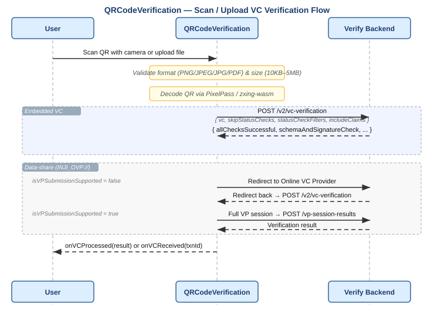

# VC Verification — Scan and Upload

Inji Verify supports VC verification by scanning a QR code with the device camera or uploading a QR code image. The `QRCodeVerification` SDK component handles both modes. See [OpenID4VP_Inji_Verify_SDK.md](./OpenID4VP_Inji_Verify_SDK.md) for full prop reference.

---

## Index

1. [Supported QR Code Formats](#supported-qr-code-formats)
2. [Verification Flow](#verification-flow)
3. [Verification Request Options](#verification-request-options)
4. [Result Shapes](#result-shapes)
5. [Format-Specific Verification Details](#format-specific-verification-details)
6. [File Upload Constraints](#file-upload-constraints)
7. [Camera Scan Constraints](#camera-scan-constraints)

---

## Supported QR Code Formats

| VC Format | Identifier | How it arrives |
|---|---|---|
| W3C JSON-LD | `ldp_vc` | JSON object embedded in QR |
| IETF SD-JWT VC | `dc+sd-jwt` / `vc+sd-jwt` | Compact string embedded in QR |
| Claim 169 / CWT | auto-detected | Base45 + zlib/Brotli compressed in QR |
| ISO mdoc / mDL | `mso_mdoc` | Base64url CBOR string embedded in QR |
| Data-share URL | `INJI_OVP://` prefix | Redirect URL to Online VC Provider |

The component detects the format automatically after decoding.

---

## Verification Flow



### Embedded VC (JSON-LD, SD-JWT, CWT, mDL)

1. User scans or uploads a file containing an embedded VC.
2. SDK decodes the QR using [PixelPass](https://github.com/inji/pixelpass) / `zxing-wasm`.
3. SDK submits the credential to `POST /v2/vc-verification`.
4. Backend verifies via the `vc-verifier` library and returns the result.
5. SDK calls `onVCProcessed(result)` or `onVCReceived(txnId)`.

### Data-Share URL (`INJI_OVP://`)

When the QR contains a redirect URL to an Online VC Provider rather than an embedded credential, two modes are available via the `isVPSubmissionSupported` prop:

**`isVPSubmissionSupported=false`:** SDK redirects directly to the Online VC Provider with `client_id` and `redirect_uri`. The provider returns an OpenID4VP 1.0 DCQL `vp_token` in the redirect hash (URL-encoded or plain JSON keyed by credential query id). The SDK extracts the VC. It submits the VC to `/v2/vc-verification` when `onVCProcessed` is configured, or to the VC-submission flow when `onVCReceived` is configured.

**`isVPSubmissionSupported=true`:** SDK creates a full VP session (`POST /v2/vp-session-request`), redirects to the provider with the full authorization parameters, receives a `response_code` on return, and fetches results via `POST /vp-session-results`. See [OpenID4VP-1.0.0.md](./OpenID4VP-1.0.0.md) for the complete VP flow.

**Note:** Verify UI sets `isVPSubmissionSupported` via configuration `VP_SUBMISSION_SUPPORTED` and it is **true** by default.

---

## Verification Request Options

Passed via the `vcVerificationV2Request` prop on `QRCodeVerification`:

| Option | Type | Default | Description |
|---|---|---|---|
| `skipStatusChecks` | `boolean` | `false` | Skip revocation / suspension checks |
| `statusCheckFilters` | `string[]` | `[]` | Run only the listed checks |
| `includeClaims` | `boolean` | `false` | Include extracted claims in the result |

---

## Result Shapes

**`summariseResults=true` (default):**
```json
[
  {
    "vc": { "...": "..." },
    "verificationResponse": {
      "verificationStatus": "SUCCESS"
    }
  }
]
```

`verificationStatus` values: `SUCCESS`, `INVALID`, `EXPIRED`, `REVOKED`.

**`summariseResults=false`:**
```json
[
  {
    "vc": { "...": "..." },
    "verificationResponse": {
      "allChecksSuccessful": true,
      "schemaAndSignatureCheck": { "valid": true, "error": null },
      "expiryCheck": { "valid": true },
      "statusCheck": [{ "purpose": "revocation", "valid": true, "error": null }],
      "claims": { "name": "Alice" }
    }
  }
]
```

---

## Format-Specific Verification Details

| Format | Signature check | Expiry field | Revocation | Holder binding |
|---|---|---|---|---|
| `ldp_vc` | JSON-LD proof | `expirationDate` / `validUntil` | BitstringStatusList | VP proof |
| `dc+sd-jwt` / `vc+sd-jwt` | JWT signature + disclosures | `exp` claim | Not applicable | KB-JWT (aud, nonce, iat, sd_hash, signature) |
| CWT (Claim 169) | COSE signature | CWT `exp` claim | Not applicable | Not applicable |
| `mso_mdoc` | COSE `issuerAuth` | MSO `validityInfo` | Not supported | Not applicable |

Scan and upload accept an ISO 18013-5 mdoc, including an mDL (`docType` `org.iso.18013.5.1.mDL`). This path does not cover OpenID4VP presentation.

The backend detects the credential before the CWT and JSON-LD checks: a base64url string whose first CBOR map contains `issuerAuth` and `nameSpaces`, `issuerSigned`, or `documents`. It verifies that credential as `mso_mdoc`. Revocation is not checked, so `statusCheck` is empty.

The result screen follows the same display path as SD-JWT and CWT. `summariseResults` stays at its default, so `onVCProcessed` still receives only `verificationStatus` plus the original credential in `vc`. The UI decodes that base64url string and shows `docType` together with the issuer-signed data elements (`family_name`, `given_name`, and the rest). `POST /v2/vc-verification` also returns those claims when `includeClaims` is `true`; the scan and upload screen does not read that field.

JSON-LD, SD-JWT, and CWT are described in [VC_Format_W3C_LDP_VC.md](./VC_Format_W3C_LDP_VC.md), [VC_Format_IETF_SD_JWT.md](./VC_Format_IETF_SD_JWT.md), and [VC_Format_Claim_169.md](./VC_Format_Claim_169.md).

---

## File Upload Constraints

| Constraint | Value |
|---|---|
| Accepted formats | PNG, JPEG, JPG, PDF |
| Minimum size | 10 KB |
| Maximum size | 5 MB |

Files outside these constraints are rejected before any network call is made.

---

## Camera Scan Constraints

| Setting | Value |
|---|---|
| Session expiry | 60 seconds |
| Frame processing interval | 100 ms |
| Frame rate throttle | ~2 frames/sec |
| Ideal resolution | 2560 × 1440 |
| Zoom | Adjustable slider (mobile only, when `isEnableZoom=true`) |

QR codes are decoded from camera frames using `zxing-wasm`.
